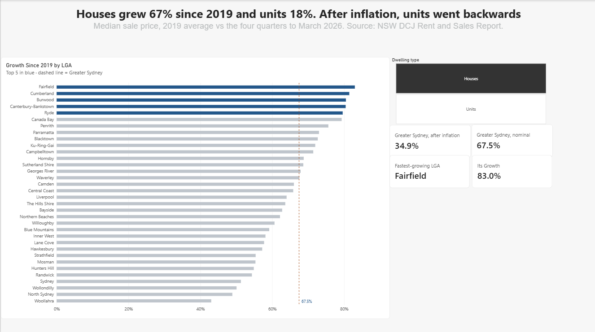

# Sydney Housing Price Growth by LGA, 2019–2026

Since 2019, Greater Sydney's median house price rose 67.5% (34.9% after inflation) and its median unit price rose 18.1% (down 4.8% after inflation), with Fairfield leading house growth at 83.0% and Hawkesbury leading unit growth at 58.8%.



[Trends](powerbi/page2_trends.png) · [Why](powerbi/page3_why.png) · [Notes](powerbi/page4_notes.png) · [Full report (PDF)](powerbi/sydney_housing_report.pdf)

Links inside the PDF aren't clickable.

## Question

Which Greater Sydney LGAs have had the fastest median house and unit price growth since 2019,
and what do the fastest-growing areas have in common?

## Key findings

1. Across Greater Sydney, the median house price rose 67.5% since 2019 (34.9% after inflation). The median unit price rose 18.1%, which is a 4.8% fall after inflation.
2. Seven of the 10 fastest-growing house LGAs are in DCJ's Middle Ring (about 7–21 km from the CBD). Fairfield led houses at 83.0%, and Hawkesbury led units at 58.8%.
3. Fast-growing house LGAs were the cheaper areas in 2019 and had lower household incomes at the 2016 Census. Price, income and rent move together, so the tests can't say which one matters. For units, none of the five factors showed a clear link.

## Data sources

| Dataset | Source | Licence | Period used | Downloaded |
|---|---|---|---|---|
| DCJ sales tables | [Rent and Sales Report](https://dcj.nsw.gov.au/about-us/families-and-communities-statistics/housing-rent-and-sales/rent-and-sales-report.html), [issue archive](https://dcj.nsw.gov.au/about-us/families-and-communities-statistics/housing-rent-and-sales/previous-rent-and-sales-reports.html) | CC BY 4.0 | Mar 2019–Mar 2026 | 2026-11-25 |
| DCJ rent tables | [Rent and Sales Report archive](https://dcj.nsw.gov.au/about-us/families-and-communities-statistics/housing-rent-and-sales/previous-rent-and-sales-reports.html) | CC BY 4.0 | Mar–Dec 2019 | 2026-11-25 |
| ABS Regional Population (ERP) | [Regional population](https://www.abs.gov.au/statistics/people/population/regional-population/2024-25) | CC BY 4.0 | Jun 2016 and Jun 2019 | 2026-11-25 |
| ABS Census 2016 G02 | [Census DataPacks](https://www.abs.gov.au/census/find-census-data/datapacks) | CC BY 2.5 AU | 2016 Census | 2026-11-25 |
| ABS CPI Sydney (A2325806K) | [Consumer Price Index, Table 17](https://www.abs.gov.au/statistics/economy/price-indexes-and-inflation/consumer-price-index-australia/sep-2026) | CC BY 4.0 | Mar 2019–Mar 2026 | 2026-11-25 |
| ABS ASGS 2025 LGA boundaries | [ABS LGA polygons](https://geo.abs.gov.au/arcgis/rest/services/Hosted/LGA_Regional_Population_2025/FeatureServer/1) | CC BY 4.0 | 2025 boundaries | 2026-11-25 |
| Heritage NSW GPO point | [State Heritage Register](https://mapprod3.environment.nsw.gov.au/arcgis/rest/services/HMS/Heritage/MapServer/5) | CC BY 4.0 | Fixed Sydney GPO location | 2026-11-25 |

See the [full data screening](docs/data_sources.md) for candidate sources and how they were assessed.

## Method

- Reshape published sales tables to one row per area, quarter and dwelling type. Non-strata sales represent houses and strata sales represent units. Suppressed values stay blank.
- Use DuckDB to join LGA factors by ABS code. Common table expressions organise the steps, and window functions number the quarters and rank growth. [SQL transform](sql/transform.sql)
- For each dwelling type, compare the average of the four quarterly medians in 2019 with the average of the latest four quarters, Jun 2025–Mar 2026. Adjust nominal growth `g` for inflation with `(1 + g) / cpi_ratio − 1`, using the ratio of average Sydney CPI across the same windows.
- Run pairwise Spearman tests, applying Holm correction to the two exploratory factors (D07). These are 2016 household income and 2019 median rent. Use an overlap matrix to show how the factors correlate. Regression coefficients would be unstable given the small sample and strongly correlated factors (D09).
- Build a Power BI star schema with LGA, date and dwelling dimensions. DAX measures calculate growth and price indexes and update with report filters.
- Compare Power BI nominal growth with the Python and SQL output. The hidden cross-check page recorded zero differences. [Cross-check screenshot](powerbi/crosscheck.png)

## Limitations

- **Revisions.** The main series uses first-published medians. Woollahra house growth was 43.0% in that series and 64.8% using revised estimates (D06/D08).
- **Low sales.** Quarters with 30 or fewer sales can have volatile medians, and two headline results rest partly on them. Hawkesbury, the fastest-growing unit LGA, had three low-sales quarters in the baseline and one in the latest window. Burwood, third for houses, had three in the baseline. Hunters Hill units had four and three.
- **Missing baseline.** Wollondilly units have no published 2019 median and are excluded from the unit rankings (D05).
- **Small sample.** The 34 LGAs support tests of association. The tests cannot establish causation or separate the effects of price, income and rent.
- **Regional medians.** Greater Sydney and the rings use DCJ's published rows. The analysis never averages medians across LGAs (D04).
- **Distance.** Distance is the straight-line distance from each LGA's geometric centroid (2025 boundaries) to the Sydney GPO. In large semi-rural LGAs such as Hawkesbury, Blue Mountains and Wollondilly, the centroid can sit far from where most people live.
- **Publication lag.** DCJ's sales figures arrive months after the reference quarter. Its methodology describes initial reporting after three months and more complete notifications by six months. [DCJ sales explanatory notes](https://dcj.nsw.gov.au/about-us/families-and-communities-statistics/housing-rent-and-sales/explanatory-notes.html)

## How to reproduce

Run these commands from the repository root to set up Python with `uv` and install the pinned dependencies.

```bash
uv venv --python 3.12 .venv
uv pip install --python .venv/bin/python -r requirements.txt
```

The [download script](scripts/download_data.py) fetches missing sales and factor inputs into `data/raw/` and extracts the required Census files. It checks the SHA-256 hashes of existing, listed files against the manifest before downloading. New downloads are hashed and recorded. The repository supplies the LGA lookup.

```bash
.venv/bin/python scripts/download_data.py
```

Run the notebooks in order. Keep a network connection available while running the exploration and cleaning notebooks for the first time. Both install DuckDB's `spatial` extension, which DuckDB downloads when it first needs it.

```bash
.venv/bin/jupyter nbconvert --to notebook --execute --inplace notebooks/01_explore.ipynb
.venv/bin/jupyter nbconvert --to notebook --execute --inplace notebooks/02_clean.ipynb
.venv/bin/jupyter nbconvert --to notebook --execute --inplace notebooks/03_analysis.ipynb
```

Open the [Power BI report](powerbi/sydney_housing.pbix) in Power BI Desktop on Windows. Go to **Home → Transform data ▾ → Edit parameters**, set `RepoPath` to the clone folder with a trailing backslash (`\`), then select **Refresh**.

## Repo structure

```text
data/raw/          original downloads and their manifest
data/reference/    LGA lookup and region assignments
data/interim/      cleaned sales, LGA factors and CPI
data/processed/    analysis and Power BI CSVs
notebooks/         exploration, cleaning and analysis
sql/               DuckDB transformations and distance calculation
scripts/           source download and verification
src/               reserved for shared Python helpers
powerbi/           Power BI workbook, screenshots and PDF export
docs/              project plan, sources, data dictionary and decisions
docs/figures/      plots generated by the analysis notebook
tasks/             task specs, reports and reviews
```

## Tools used

Python with pandas, SciPy, Matplotlib, seaborn, openpyxl, xlrd and Requests, plus Jupyter, ipykernel and nbconvert. DuckDB SQL, Power BI Desktop, and Git/GitHub.

**AI assistance.** Claude wrote the task specs, reviews and Power BI guides. Codex implemented the Python and SQL tasks under review. I made every decision, built the Power BI model, report and DAX measures, and checked every result.
